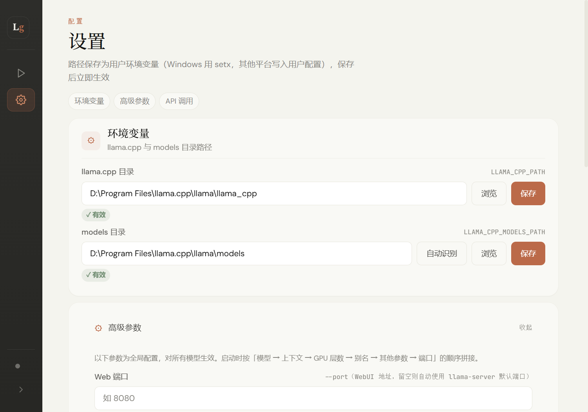
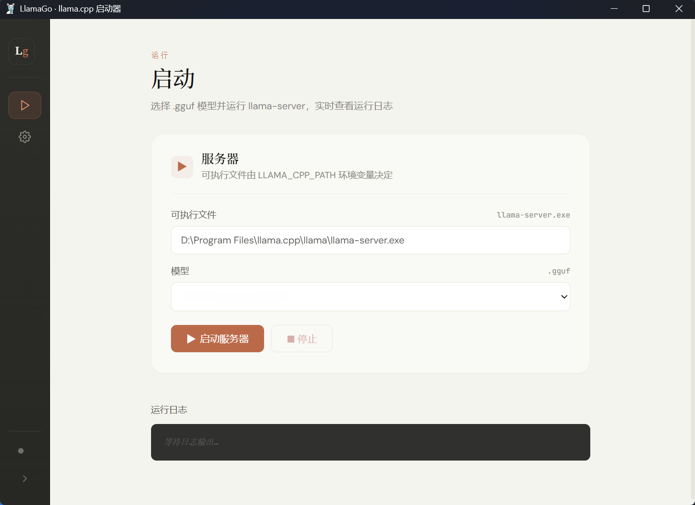

# LlamaGo

> 将一行命令压缩成一次点击 —— 为 [llama.cpp](https://github.com/ggml-org/llama.cpp) 打造的桌面启动器

<!--  -->

**告别终端**，用图形界面管理 `LlamaGo` 的生命周期：扫描、启动、守护、日志，一切尽在掌握。

<p align="center">
  
  
    
  
  
  
  
</p>

---

## 特性一览

- **一键启停**：点击按钮启动/停止 `llama-server`，进程生命周期由应用托管，关闭窗口不影响后台服务。
- **就绪感知**：区分「进程已启动」与「模型加载完成」，就绪前 WebUI 按钮不可用，异常退出会提示退出码。
- **自动扫描**：自动发现 `llama.cpp` 安装目录与 `.gguf` 模型文件，扫描结果需手动确认后写入环境变量。
- **WebUI 直达**：服务器就绪后，一键在默认浏览器打开 `http://127.0.0.1:<端口>`；端口取自设置，未设置时读取 `llama-server --help` 的默认值。
- **系统托盘常驻**：关闭窗口隐藏至托盘（首次会提示），服务持续运行。托盘菜单可直接启停服务、打开 WebUI 或退出。
- **实时日志面板**：stdout/stderr 逐行滚动显示，支持暂停跟随、导出与清空；前端保留最近 **1500 行**，窗口重新打开自动回填。
- **单实例保护**：同一时间只允许一个实例，重复启动会聚焦已有窗口。

---

## 快速开始

### 安装

从 [Releases](https://github.com/Abossss/LlamaGo/releases) 下载对应安装包：

| 包类型 | 文件                          | 适用场景           |
| ------ | ----------------------------- | ------------------ |
| NSIS   | `LlamaGo_0.1.0_x64-setup.exe` | 图形化安装（推荐） |
| MSI    | `LlamaGo_0.1.0_x64.msi`       | 企业 / 静默部署    |

> 要求：Windows 10/11（WebView2 已内置）；Linux（WebKitGTK）；macOS（WKWebView）。

### 配置路径

1. 打开「设置」→ 点击「**自动扫描**」查找 `llama-server`，在候选列表中选择要使用的目录。
2. 设置环境变量 `LLAMA_CPP_PATH` 和 `LLAMA_CPP_MODELS_PATH`（点击保存后持久化），或手动选择目录；保存 `LLAMA_CPP_PATH` 后会自动填入其下（或同级）的 `models` 文件夹（仍需点击保存）。
3. 切换到「启动」视图，模型下拉列表会自动填充。

### 启动服务

1. 选择一个 `.gguf` 模型（首次使用需配置路径）。
2. 点击「**启动服务器**」；启动页会显示即将执行的完整命令预览。
3. 日志中出现 `server is listening` 后状态变为「运行中」，此时可点击「🌐 WebUI」或调用 API。

> **端口冲突**：端口优先级为「设置中的 Web 端口 → `llama-server --help` 的默认端口 → 8080」。被占用时启动失败，请修改端口后重启。运行中修改参数，可点击「↻ 重启」立即生效。

---

## 核心机制

### 进程管理

```
[前端] → start_server → [后端 spawn] → llama-server
                                       ├─ stdout → 日志面板
                                       └─ stderr → 日志面板（加前缀）
```

- 启动时 **预检端口**，避免不必要的启动。
- 运行中每 300ms 轮询进程状态，自动感知退出并更新界面；非主动停止的退出会带上退出码提示。
- 通过日志中的 `server is listening` 判定「已就绪」，并通过 `server-ready` 事件通知前端。
- 停止策略：Unix 先 SIGTERM，5 秒后 SIGKILL；Windows 直接终止进程。
- 应用退出时同样先终止 `llama-server`：托盘「退出」、macOS Cmd+Q / Linux 关闭事件都会走清理路径，Windows 另有 Job Object 兜底。

### 路径解析优先级

`llama-server` 可执行文件路径由后端从 `LLAMA_CPP_PATH` 推导（前端不可篡改）：

1. **环境变量 `LLAMA_CPP_PATH`**（最高优先级，持久化）
2. 可执行文件所在目录 + PATH 扫描（兜底）
3. 引导用户手动设置（若均未找到）

模型扫描递归查找 `.gguf` 文件，深度上限 20 层，自动去重并跳过符号链接环；`mmproj` 视觉投影文件和分片续片（`-00002-of-00004.gguf`）会被过滤，只保留可直接加载的模型。

### 日志与状态

- 双管道独立线程转发，stderr 行添加 `[stderr]` 前缀。
- 后端环形缓冲区保留最近 200 行用于回填，前端最多展示 1500 行。
- 日志面板支持「跟随」开关（手动上滚自动暂停）与导出为 `.log` 文件。
- 应用日志（`debug.log`）记录内部诊断信息，位于应用数据目录。

### 高级参数 & API 调用

「设置 → 高级参数」中的参数为**全局配置**，对所有模型生效，启动时按固定顺序拼接：

| 参数 | 对应 CLI flag | 持久化位置 |
| ---- | ------------ | ---------- |
| Web 端口 | `--port` | `config.json` 的 `web_port` |
| 模型别名（每个 `.gguf` 一个） | `--alias` | `config.json` 的 `model_aliases` |
| API Key | 通过 `LLAMA_API_KEY` 环境变量传入 | `config.json` 的 `advanced.api_key` |
| 上下文长度 | `-c` | `config.json` 的 `advanced.ctx_size` |
| GPU 层数 | `-ngl` | `config.json` 的 `advanced.ngl` |
| 其他启动参数 | 原样追加（支持引号） | `config.json` 的 `advanced.extra_args` |

- **模型别名**：每个 `.gguf` 单独存一个短名，WebUI 里 `/v1/models` 显示的即别名（而非文件名）。
- **API Key**：支持一键随机生成（32 字符 hex）+ 显示 / 复制；未设置时 llama-server 不要求认证。
- **其他启动参数**：可填写 `--mlock`、`--threads 8` 等未在界面中单独暴露的 flag；引号内的空格会保留。
- **命令预览**：启动页的「启动命令预览」展示实际执行的命令，API Key 不会出现在命令行中。
- **API 调用面板**：显示 Base URL、模型名称、API Key、OpenAI 兼容端点与可一键复制的 `curl` 示例，并支持「测试连接」。
- 温度、最大输出 token 等生成参数由 OpenAI 客户端在请求中设置，不属于启动参数。

> 要求 llama.cpp ≥ b2100（`--alias` / `--api-key` 在该版本引入）。旧版本启动会因未知 flag 报错，UI 会显示 `启动失败` toast 并在日志中打印具体原因。

### 单实例互斥

使用 `tauri-plugin-single-instance`：再次启动时会聚焦已有窗口，而不是创建第二个实例。

---

## 用户界面

### 界面预览

LlamaGo 客户端分为「设置配置页」和「启动运行页」两大功能面板，左侧为深色侧边栏（含 Lg 图标、播放、齿轮等入口），主体为米白色卡片式布局，风格简约、分区清晰，用来可视化配置并启动 llama.cpp 模型服务，免去手动敲命令行。

**设置配置页**

配置 `llama.cpp` 运行环境，页面备注说明：配置会写入用户环境变量（Windows 用 `setx`，其他平台写入用户配置），保存后立即生效。

- **llama.cpp 目录**：填写 `llama-server` 所在目录（如 `D:\Program Files\llama.cpp\llama`），路径校验显示「√有效」，右侧带「浏览」「保存」按钮，对应环境变量 `LLAMA_CPP_PATH`。
- **models 目录（模型文件夹）**：填写 `.gguf` 模型存放目录（如 `D:\Program Files\llama.cpp\llama\models`），同样校验「√有效」并带「自动识别」「浏览」「保存」按钮，对应环境变量 `LLAMA_CPP_MODELS_PATH`。「自动识别」优先取 `<llama.cpp 目录>/models`，没有再取上一级的 `models`（常见于 `llama/llama_cpp` + `llama/models` 的目录布局）。
- 设置页顶部的分区导航可快速跳转到「环境变量 / 高级参数 / API 调用」。

<p align="center"></p>

**启动运行页**

选择 `.gguf` 模型、运行 `llama-server` 服务，并实时查看运行日志。

- **服务器配置**：自动识别出 `llama-server.exe` 完整路径（由设置页配置的环境变量读取）；模型下拉框选择 `models` 目录中的 `.gguf` 模型文件，支持刷新；下方为「启动服务器」「停止」「重启」「WebUI」按钮。
- **状态反馈**：启动后按钮显示「模型加载中…」，日志出现 `server is listening` 后变为「运行中」；异常退出会显示退出原因与退出码。
- **启动命令预览**：展开后可查看本次实际执行的完整命令。
- **运行日志**：底部黑色日志框，启动服务后实时打印运行日志、加载进度与报错信息，支持跟随、导出和清空。

<p align="center"></p>

**工作流程**：先在设置页配置好 `llama.cpp` 主目录与模型目录（校验有效并保存环境变量）→ 切换到启动页，下拉框自动读取 `models` 目录中的模型 → 选中模型点击「启动服务器」，即可拉起 llama.cpp 的 Web API 服务。

### 快捷键

| 按键     | 功能                         |
| -------- | ---------------------------- |
| `1`      | 切换到「设置」视图           |
| `2`      | 切换到「启动」视图           |
| 窗口关闭 | 最小化到托盘（服务继续运行） |
| 托盘左键 | 唤出主窗口                   |

> 快捷键仅在焦点不在输入框时生效。

### 托盘菜单

| 菜单项         | 行为                                       |
| -------------- | ------------------------------------------ |
| 状态行（禁用） | 显示「服务器: 运行中 / 启动中 (PID x)」或「已停止」 |
| 启动 / 停止    | 一键切换；启动时优先使用上次保存的模型     |
| 打开 WebUI     | 仅服务运行时可用                           |
| 显示主窗口     | 唤回主界面                                 |
| 退出           | **先停服务，再退出进程**                   |

---

## 开发与构建

### 依赖

- Rust（稳定版）
- Node.js（npm，用于 Vite 前端构建与 Tauri CLI）
- 平台 WebView2 / WebKitGTK / WKWebView

### 构建命令

```sh
cd frontend
npm install            # 安装前端依赖（Vite + Vue 3 + TypeScript）

# 仅前端开发（Vite 开发服务器，端口 5173）
npm run dev

cd ..
cd src-tauri
cargo tauri dev        # 开发模式（自动触发 beforeDevCommand → Vite 热重载）
cargo tauri build      # 生产构建（先 npm run build 产出 frontend/dist），安装包输出至 target/release/bundle/
```

> 前端为标准 Vite 工程（`frontend/`）：Vue 3 SFC + 组合式 API + TypeScript，按 UI 语义拆分为多个组件（`src/components/*`），共享状态封装在 `src/composables/*`。

---

## 接口清单

### 后端命令

| 命令                     | 作用                                                       | 返回                           |
| ------------------------ | ---------------------------------------------------------- | ------------------------------ |
| `start_server`           | 启动 `llama-server`（args / 别名 / API Key）               | PID 字符串                     |
| `stop_server`            | 停止服务                                                   | 终止信息                       |
| `get_status`             | 查询运行状态                                               | `(running, ready, pid, port)`  |
| `get_status_full`        | 查询运行状态（含别名 + API Key）                           | `{running, ready, pid, port, model_alias, api_key}` |
| `check_config`           | 读取上次配置（含别名表 + 高级参数）                        | exec / model 路径 + aliases + advanced |
| `save_config`            | 保存模型选择 + 别名 + 高级参数 + Web 端口                  | —                              |
| `get_env_settings`       | 读取环境变量及有效性                                       | `llama_valid` / `exec_path` / `models_valid` |
| `save_env_var`           | 校验并持久化环境变量                                       | —                              |
| `suggest_models_path`    | 检测 `<llama.cpp>/models` 或上一级 `models` 是否存在       | 建议路径或 `null`              |
| `scan_llama_cpp`         | 自动扫描 `llama.cpp` 目录                                  | 候选路径列表                   |
| `cancel_scan`            | 取消扫描                                                   | —                              |
| `list_models`            | 递归列出可加载的 `.gguf`（过滤 mmproj / 分片续片，排序）   | 路径列表                       |
| `get_log_history`        | 获取后端最近 200 行日志                                    | 日志数组                       |
| `pick_folder`            | 打开原生目录选择器                                         | 路径或 `null`                  |
| `open_url`               | 用默认浏览器打开链接                                       | —                              |
| `export_log`             | 通过保存对话框导出日志                                     | 保存路径或 `null`              |

### 前端事件

| 事件                         | 触发时机 / 负载                                   |
| ---------------------------- | ------------------------------------------------- |
| `log-line`                   | 每行 stdout/stderr（字符串）                      |
| `process-exit`               | 非主动停止的进程退出 `{code, success}`            |
| `server-started`             | spawn 成功（PID）                                 |
| `server-ready`               | 日志报告 `server is listening`（PID）             |
| `server-status`              | 运行状态变化 `{running, ready, pid, port}`        |
| `scan-message` / `scan-done` | 扫描进度 / 完成                                   |
| `toast`                      | 全局通知                                          |

---

## 已知局限

- **macOS 未经实测**：由于作者没有 Mac，无法对 macOS 平台进行实际测试，理论上支持但可能存在未知问题，敬请见谅。欢迎有 Mac 的朋友反馈问题或提交修复。
- **API Key 明文存储**：`--api-key` 以明文存入应用数据目录的 `config.json`，本地工具可接受，但请知悉。
- **`setx` 生效延迟**：环境变量保存后，本进程即时生效，但已打开的其它终端需重启；若 LlamaGo 从旧环境中启动，会回读 `HKCU\Environment` 作为兜底。
- **Windows 停止非优雅**：直接调用 `TerminateProcess`，不会等待 `llama-server` 落盘。
- **托盘启动自动选模型**：若未保存过模型，会选用字典序第一个 `.gguf`，可能不符合预期；托盘启动会复用已保存的别名、API Key 与高级参数。
- **就绪判定依赖日志**：若使用的 llama.cpp 分支不输出 `server is listening`，界面会一直停留在「加载模型…」，但服务本身仍可通过日志确认。
- **单实例作用域**：互斥体基于会话（`Local\`），多用户 / 远程桌面各自独立。
- **配置自动恢复**：`config.json` 解析失败时会被移走为 `config.json.bak.<时间戳>` 并记录到 `debug.log`，之后从默认配置重新开始（原有设置需重新配置）。

---

## 法律与引用

- **LlamaGo 源码**：MIT 许可证（见 [LICENSE](LICENSE)）。
- **特别感谢 [llama.cpp](https://github.com/ggml-org/llama.cpp)**：本项目离不开 llama.cpp 强大的本地推理能力，向其作者与社区致敬。
- **`llama-server` / WebUI**：属于 [llama.cpp](https://github.com/ggml-org/llama.cpp)（MIT），版权归原项目。
- **`.gguf` 模型**：版权归各模型作者，用户自行选择并遵守相应许可。
- **Vue 3 + Vite**：MIT。

如需引用：

```bibtex
@software{llamago,
  title        = {LlamaGo: A Desktop Launcher for llama.cpp},
  author       = {LlamaGo Contributors},
  year         = {2026},
  url          = {https://github.com/Abossss/LlamaGo},
  note         = {Tauri desktop GUI managing the llama-server lifecycle}
}
```

---

## 贡献

欢迎提交 Issue 和 Pull Request。请保持代码风格一致（无强制 lint 配置）。

---

## English Summary

**LlamaGo** is a Tauri-based desktop launcher for llama.cpp's `llama-server`. It provides:

- One‑click start/stop/restart with process lifecycle management.
- Ready-state detection (process running vs. model loaded) and exit-code feedback.
- Auto‑scan for llama.cpp and `.gguf` models, with mmproj/shard filtering.
- WebUI launcher at the configured port (falls back to the binary's own default).
- System tray residency with a live log panel (follow / export).
- Single‑instance protection.

### Quick Start

1. Set `LLAMA_CPP_PATH` and `LLAMA_CPP_MODELS_PATH` (or auto‑scan).
2. Pick a `.gguf` model.
3. Click **Start Server**, wait for `server is listening`, then click **WebUI**.

### Build from Source

```sh
cd frontend && npm install && cd ..
cd src-tauri
cargo tauri dev
cargo tauri build
```

### License

MIT (code), model licenses apply separately.

---

_LlamaGo — one click, not one command._
